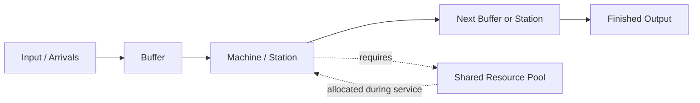

# Production Line Simulator — User Manual
# راهنمای کاربر شبیه‌ساز خط تولید

This practical guide explains the main controls and results in the Production Line Simulator. The software is a browser-based simulator; model settings are edited in the page, and models can be saved and loaded locally.

این راهنمای کاربردی، کنترل‌ها و نتایج اصلی شبیه‌ساز خط تولید را توضیح می‌دهد. نرم‌افزار در مرورگر اجرا می‌شود؛ تنظیمات مدل در صفحه وارد می‌شوند و مدل‌ها را می‌توان به‌صورت محلی ذخیره و بارگذاری کرد.

---

## English

### 1. Quick start

1. Open the [Production Line Simulator](https://abb-omidi.github.io/production-line-simulator/).
2. Review the shift duration and arrival/input-rate settings. Time values are expressed in minutes.
3. Add or edit the machines (stations) in the line.
4. Configure each machine's processing-time distribution and parameters.
5. Set buffers, scrap percentage, and any shared-resource requirements.
6. Press **Run** to simulate the shift. Review the KPIs, machine results, and utilization charts.
7. Save the model configuration if you want to reuse it later.

Start with one or two machines and simple processing times. Add failure and resource constraints after confirming that the basic flow behaves as expected.

### 2. Typical production flow

A machine may wait before processing if a required shared resource is unavailable. Buffer capacity can also affect blocking and flow between stations.

### 3. Simulation settings and controls

- **Shift duration:** total time simulated for one shift, in minutes.
- **Input/arrival rate:** controls how frequently jobs enter the line; check the unit shown beside the field.
- **Run:** starts a simulation using the current configuration.
- **Monte Carlo:** runs repeated replications to show how results vary between runs.
- **Save / Load:** exports or imports the model configuration as a local file. Keep the file if you want to reproduce the same scenario later.
- **Log / diagnostics:** helps identify invalid settings or unusual simulation behavior.

Exact control labels may vary slightly as the web app evolves.

### 4. Machine / station definition

Configure each station using the available fields:

- **Name:** an identifiable station or machine name.
- **Processing-time distribution and parameters:** the model for job service time.
- **Buffer capacity:** number of jobs that can wait in the configured buffer. A restrictive buffer may block upstream stations.
- **Scrap percentage:** fraction of processed jobs rejected at that station.
- **MTTF / MTBF and MTTR:** time-to-failure and repair-duration inputs used for breakdown modeling. If failure modeling is not enabled or used in the scenario, these values do not by themselves improve or speed up a machine.
- **Resource demand:** number of operators, tools, or technicians needed by a job or machine, where those fields are provided.

Change one parameter at a time while validating a model. This makes it easier to explain any change in throughput or utilization.

### 5. Processing-time distributions

Use the distribution whose shape matches the process:

| Distribution | Practical interpretation |
|---|---|
| **Normal** | Values cluster around a mean; specify the spread as well as the mean. Check whether the chosen parameters are sensible for non-negative process times. |
| **Gamma** | Positive, often right-skewed durations. |
| **Poisson** | Discrete non-negative counts; use only where a count-valued model is appropriate. |
| **Exponential** | Positive, memoryless durations or inter-arrival times. |
| **Weibull** | Flexible positive-time distribution often used for lifetime and reliability modeling. |
| **Triangular** | Minimum, most likely, and maximum estimates when data are limited. |

Parameter meanings depend on the distribution. Confirm the input labels in the software rather than assuming that all distributions use the same parameter names.

### 6. Shared resources: operators, tools, and technicians

Shared resources represent limited capacity used by multiple stations.

- Set the available count for each resource pool.
- Set the quantity required by a job or machine.
- When processing starts, the simulator allocates the required resources; they become available again after service finishes.
- If the required resource is unavailable, the job or machine may need to wait.
- A technician may be needed to repair a failed machine; if all technicians are occupied, repair may be delayed until one is free.
- Resource counts are whole-number capacities in the current version; fractional headcount such as 0.5 operator is not directly supported.

**Important:** assigning two operators to a single-server machine does not automatically halve its processing time. Extra operators can support simultaneous work at different stations when those stations require them.

### 7. Breakdowns and repairs

Use the failure and repair settings to investigate reliability effects. MTTF/MTBF describes the typical interval between failures according to the selected model; MTTR describes repair duration. If a technician is required, the repair can also wait for technician availability.

Run a baseline without failures first, then enable failures and compare throughput, output, machine busy time, and resource utilization.

### 8. 3D line animation and simulation time

The 3D view illustrates movement between stations and the progress of the simulation. Use **Run** to start the simulation and observe the flow. The animation is a visualization of the simulated model; use the numerical results and event log for performance conclusions.

### 9. Reading the results

- **Throughput / output:** number of jobs completed during the simulated shift.
- **Cycle time:** time a job spends moving through the modeled system, according to the displayed metric.
- **Utilization:** proportion of the modeled shift that a machine or resource is busy.
- **Availability / OEE:** reliability and performance-related indicators where shown.
- **Bottleneck:** a station or constraint limiting overall output; check both machine load and upstream/downstream blocking or starvation.

The machine result table provides station-level detail. The utilization dashboard separates **machine busy time** from the **remaining idle time**. Idle time may include waiting for jobs, blocked time, downtime, or other non-processing states; it does not necessarily mean that the machine is available and ready to work.

### 10. Individual resource utilization

Where individual resource charts are displayed, each operator, tool, or technician has a separate utilization trace. Compare individual traces with the total pool and machine charts to see whether capacity is concentrated on particular units or whether the pool is generally overloaded.

A high utilization value alone does not prove that a resource is the bottleneck. Confirm it by looking at throughput, queueing, waiting, and blocking.

### 11. Monte Carlo analysis

Monte Carlo runs repeated simulation replications. Use it when processing times, arrivals, or failures are stochastic.

1. Choose a sensible number of replications.
2. Run the analysis.
3. Compare average results and the variation between replications.
4. Avoid making decisions from a single lucky or unlucky run.

More replications usually give a more stable estimate, but take longer to complete.

### 12. Save, load, and troubleshooting

- Save a configuration file before testing major changes.
- Give scenario files descriptive names, for example `baseline.json`, `extra_operator.json`, or `failure_scenario.json`.
- Load the intended file before comparing scenarios and check that all settings were restored.
- If throughput is zero, verify that jobs can arrive, processing times are valid, machine and buffer capacities are not contradictory, and required shared resources are available.
- If a machine appears idle, check starvation, blocking, resource waiting, and breakdown/repair states before assuming that it has excess capacity.
- If results look implausible, simplify the model and add constraints back one at a time.

---

## فارسی

### ۱. شروع سریع

۱. [شبیه‌ساز خط تولید](https://abb-omidi.github.io/production-line-simulator/) را باز کنید.
۲. مدت شیفت و نرخ ورود محصول را بررسی کنید. واحد زمان در نرم‌افزار دقیقه است.
۳. ایستگاه‌ها یا ماشین‌های خط را اضافه یا ویرایش کنید.
۴. توزیع زمان پردازش و پارامترهای هر ماشین را تعیین کنید.
۵. ظرفیت بافر، درصد ضایعات و نیاز به منابع مشترک را تنظیم کنید.
۶. روی **Run** بزنید و شاخص‌ها، جدول نتایج ماشین‌ها و نمودارهای بهره‌برداری را بررسی کنید.
۷. برای استفاده مجدد، تنظیمات مدل را ذخیره کنید.

بهتر است ابتدا خطی با یک یا دو ماشین و زمان پردازش ساده بسازید. پس از اطمینان از عملکرد جریان پایه، خرابی و محدودیت منابع را اضافه کنید.

### ۲. جریان معمول خط تولید

نمودار بالا مسیر نمونه ورود محصول، بافر، ماشین، منبع مشترک و خروجی نهایی را نشان می‌دهد. اگر منبع موردنیاز آزاد نباشد، ماشین یا سفارش ممکن است منتظر بماند. ظرفیت بافر نیز می‌تواند باعث انسداد ایستگاه بالادست شود.

### ۳. تنظیمات و دکمه‌ها

- **مدت شیفت:** زمان کل شبیه‌سازی یک شیفت، بر حسب دقیقه.
- **نرخ ورود محصول:** تعیین می‌کند محصولات با چه تواتری وارد خط شوند؛ واحد درج‌شده کنار فیلد را بررسی کنید.
- **Run:** اجرای شبیه‌سازی با تنظیمات فعلی.
- **Monte Carlo:** اجرای چند تکرار برای بررسی تغییرپذیری نتایج.
- **Save / Load:** ذخیره یا بارگذاری تنظیمات مدل در قالب یک فایل محلی.
- **Log / Diagnostics:** کمک به شناسایی تنظیمات نامعتبر یا رفتار غیرعادی شبیه‌سازی.

ممکن است با توسعه نرم‌افزار، عنوان بعضی کنترل‌ها کمی تغییر کند.

### ۴. تعریف ماشین یا ایستگاه

- **نام:** نام قابل‌شناسایی برای ماشین یا ایستگاه.
- **توزیع زمان پردازش و پارامترها:** مدل آماری زمان خدمت به هر محصول.
- **ظرفیت بافر:** تعداد محصولی که می‌تواند در بافر تعریف‌شده منتظر بماند. محدودیت بافر ممکن است ایستگاه قبلی را مسدود کند.
- **درصد ضایعات:** سهم محصولاتی که پس از پردازش در آن ایستگاه رد می‌شوند.
- **MTTF / MTBF و MTTR:** ورودی‌های مربوط به فاصله زمانی بین خرابی‌ها و مدت تعمیر. اگر سناریو از مدل خرابی استفاده نکند، وارد کردن این اعداد به‌تنهایی سرعت ماشین را بیشتر نمی‌کند.
- **نیاز به منابع:** تعداد اپراتور، ابزار یا تعمیرکار موردنیاز، در صورت وجود این فیلدها.

برای اعتبارسنجی مدل، هر بار تنها یک پارامتر را تغییر دهید تا اثر آن بر خروجی و بهره‌برداری مشخص باشد.

### ۵. توزیع‌های زمان پردازش

| توزیع | کاربرد معمول |
|---|---|
| **Normal ـ نرمال** | زمان‌ها پیرامون میانگین متمرکز هستند؛ میانگین و میزان پراکندگی را مشخص کنید. |
| **Gamma ـ گاما** | زمان‌های مثبت که معمولاً به سمت مقادیر بزرگ‌تر دنباله دارند. |
| **Poisson ـ پواسون** | مدل گسسته برای شمارش؛ تنها زمانی استفاده شود که متغیر واقعاً شمارشی باشد. |
| **Exponential ـ نمایی** | زمان‌های مثبت و بدون حافظه یا فاصله زمانی بین ورودها. |
| **Weibull ـ وایبل** | توزیع انعطاف‌پذیر برای زمان‌های مثبت، از جمله مدل‌سازی عمر و قابلیت اطمینان. |
| **Triangular ـ مثلثی** | حداقل، محتمل‌ترین مقدار و حداکثر؛ مناسب زمانی که داده کافی ندارید. |

معنای پارامترها بین توزیع‌ها متفاوت است. برچسب فیلدها در خود نرم‌افزار را بررسی کنید و فرض نکنید همه توزیع‌ها پارامترهای یکسانی دارند.

### ۶. منابع مشترک: اپراتور، ابزار و تعمیرکار

منابع مشترک، ظرفیت محدودی هستند که چند ایستگاه از آن استفاده می‌کنند.

- تعداد منابع موجود را برای هر گروه تعیین کنید.
- تعداد موردنیاز هر محصول یا ماشین را وارد کنید.
- هنگام شروع پردازش، منابع لازم تخصیص می‌یابند و پس از پایان خدمت آزاد می‌شوند.
- اگر منبع موردنیاز آزاد نباشد، پردازش ممکن است منتظر بماند.
- در صورت نیاز به تعمیرکار برای رفع خرابی، اگر همه تعمیرکاران مشغول باشند، تعمیر تا آزاد شدن یکی از آن‌ها به تأخیر می‌افتد.
- در نسخه فعلی، ظرفیت منابع عدد صحیح است؛ تعریف مستقیم ۰٫۵ اپراتور پشتیبانی نمی‌شود.

**نکته مهم:** اختصاص دو اپراتور به یک ماشین تک‌خدمتی، زمان پردازش آن ماشین را خودبه‌خود نصف نمی‌کند. اپراتورهای بیشتر می‌توانند از کار هم‌زمان در ایستگاه‌های مختلف پشتیبانی کنند.

### ۷. خرابی و تعمیر

از تنظیمات خرابی و تعمیر برای بررسی اثر قابلیت اطمینان استفاده کنید. MTTF/MTBF فاصله معمول بین خرابی‌ها و MTTR مدت تعمیر را توصیف می‌کند. اگر تعمیرکار لازم باشد، شروع یا ادامه تعمیر به دسترس‌پذیری او نیز وابسته است.

ابتدا یک حالت پایه بدون خرابی اجرا کنید؛ سپس خرابی‌ها را فعال کرده و خروجی، زمان کار ماشین و بهره‌برداری منابع را مقایسه کنید.

### ۸. انیمیشن سه‌بعدی و زمان شبیه‌سازی

نمای سه‌بعدی حرکت محصول بین ایستگاه‌ها و پیشرفت شبیه‌سازی را نمایش می‌دهد. برای شروع از **Run** استفاده کنید. انیمیشن نمایش تصویری مدل است؛ برای نتیجه‌گیری درباره عملکرد، شاخص‌های عددی و گزارش رخدادها را نیز بررسی کنید.

### ۹. تفسیر نتایج

- **Throughput / Output ـ توان تولید:** تعداد محصولات تکمیل‌شده در طول شیفت شبیه‌سازی‌شده.
- **Cycle Time ـ زمان چرخه:** زمان حضور محصول در سیستم مدل‌شده، مطابق تعریف شاخص نمایش‌داده‌شده.
- **Utilization ـ بهره‌برداری:** نسبت زمانی که ماشین یا منبع مشغول است به زمان شیفت مدل‌شده.
- **Availability / OEE:** شاخص‌های مرتبط با دسترس‌پذیری و عملکرد، در صورت نمایش.
- **Bottleneck ـ گلوگاه:** ایستگاه یا محدودیتی که خروجی کل خط را محدود می‌کند. بار ماشین، انسداد و کمبود محصول ورودی را بررسی کنید.

جدول نتایج جزئیات هر ماشین را نشان می‌دهد. در نمودار بهره‌برداری، **زمان مشغول بودن ماشین** از **باقی زمان بیکاری** جدا می‌شود. بیکاری می‌تواند شامل انتظار برای محصول، انسداد، توقف ناشی از خرابی یا حالت‌های غیرپردازشی دیگر باشد؛ بنابراین همیشه به معنی آماده‌به‌کار بودن ماشین نیست.

### ۱۰. بهره‌برداری جداگانه منابع

اگر نمودارهای منابع تکی نمایش داده شوند، برای هر اپراتور، ابزار یا تعمیرکار یک نمودار جدا وجود دارد. نمودارهای هر واحد را با کل گروه منابع و ماشین‌ها مقایسه کنید تا مشخص شود بار کاری روی بعضی واحدها متمرکز است یا کل گروه با کمبود ظرفیت روبه‌روست.

بهره‌برداری زیاد به‌تنهایی ثابت نمی‌کند که منبع گلوگاه است. صف، انتظار، انسداد و توان تولید را نیز بررسی کنید.

### ۱۱. تحلیل مونت‌کارلو

مونت‌کارلو چند تکرار از شبیه‌سازی را اجرا می‌کند. زمانی از آن استفاده کنید که زمان پردازش، ورود محصول یا خرابی تصادفی است.

۱. تعداد مناسبی تکرار انتخاب کنید.
۲. تحلیل را اجرا کنید.
۳. میانگین نتایج و پراکندگی بین تکرارها را بررسی کنید.
۴. بر اساس یک اجرای تصادفیِ خوش‌شانس یا بدشانس تصمیم نگیرید.

تکرار بیشتر معمولاً برآورد پایدار‌تری ایجاد می‌کند، اما زمان محاسبات را افزایش می‌دهد.

### ۱۲. ذخیره، بارگذاری و رفع اشکال

- قبل از تغییرات عمده، پیکربندی فعلی را ذخیره کنید.
- برای فایل‌ها نام معنادار بگذارید؛ مانند `baseline.json`، `extra_operator.json` یا `failure_scenario.json`.
- پیش از مقایسه سناریوها، فایل درست را بارگذاری و تنظیمات بازیابی‌شده را بررسی کنید.
- اگر خروجی صفر است، نرخ ورود، معتبر بودن زمان‌های پردازش، ظرفیت ماشین و بافر و دسترس‌پذیری منابع موردنیاز را بررسی کنید.
- اگر ماشینی بیکار به نظر می‌رسد، پیش از نتیجه‌گیری درباره ظرفیت اضافی، کمبود محصول ورودی، انسداد، انتظار برای منبع و وضعیت خرابی/تعمیر را بررسی کنید.
- اگر نتایج غیرمنطقی‌اند، مدل را ساده کنید و محدودیت‌ها را یکی‌یکی بازگردانید.

---

**Manual format note:** This repository version is a Markdown guide with a Mermaid workflow diagram. It is intended to stay easy to read and maintain alongside the software source.  
**یادداشت قالب:** نسخه موجود در مخزن، راهنمای Markdown همراه با نمودار جریان Mermaid است تا نگهداری و به‌روزرسانی آن در کنار کد نرم‌افزار آسان باشد.
